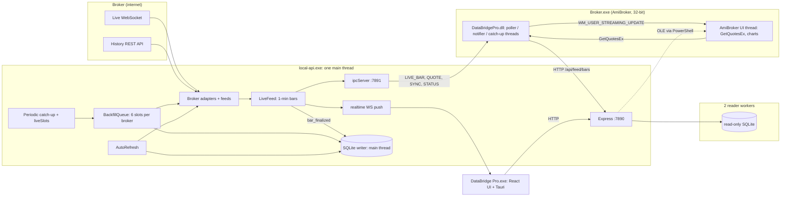
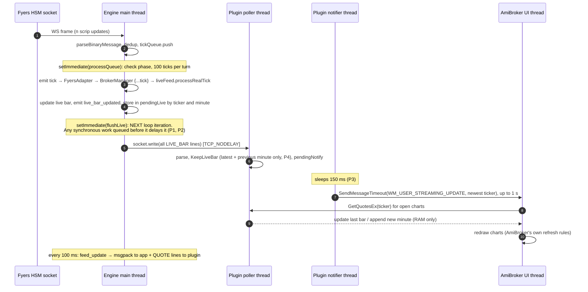
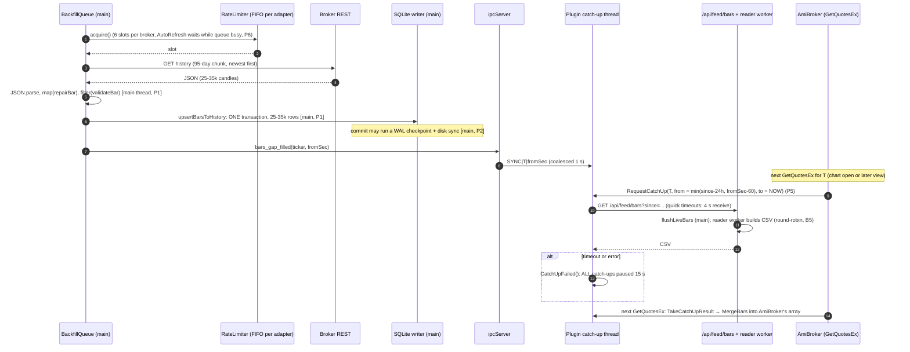
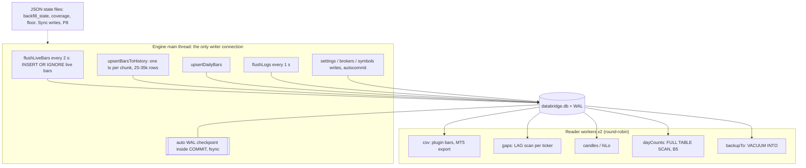
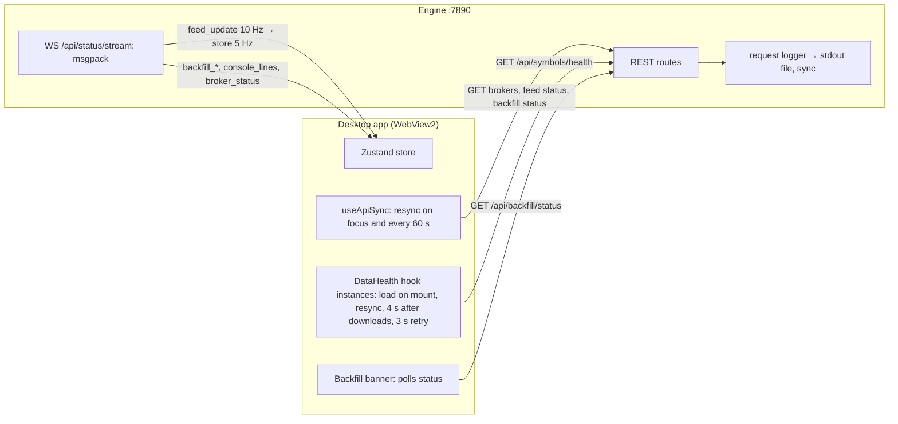
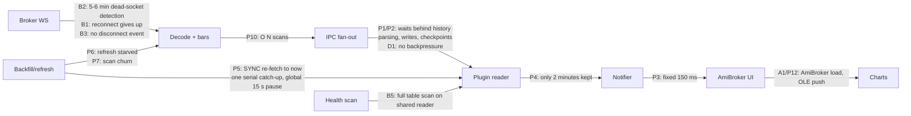

# DataBridge Pro: current architecture (as built)

How the system works at commit `8bdf906`, read from the code. Finding IDs (B*, P*, D*) refer to [DATABRIDGE_ROOT_CAUSE_ANALYSIS.md](DATABRIDGE_ROOT_CAUSE_ANALYSIS.md).

## Components and entry points

| Part | Location | Runs as | Entry point |
|---|---|---|---|
| Data engine | `apps/server` (TypeScript, Node 24, `node:sqlite`) | `local-api.exe` (Node single-executable), hidden child of the app; `tsx watch` in dev | `src/index.ts` → `app.ts`, `api/realtime.ts`, `amibroker/ipcServer.ts`, `startup.ts`, `jobs.ts` |
| Desktop app | `apps/desktop` (React + Tauri 2, Rust) | `DataBridge Pro.exe` | `src/main.tsx`; `src-tauri/src/lib.rs`, `engine.rs` (engine supervisor), `amibroker.rs` |
| AmiBroker plugin | `plugins/amibroker` (C++17, 32-bit, static CRT) | `DataBridgePro.dll` loaded by `Broker.exe` | `Plugin.cpp` (ADK exports), `DataClient.cpp` (threads, socket, HTTP) |
| Excel live prices | `plugins/excel` | RTD COM DLL | polls `/api/platforms/quotes` |
| MetaTrader 5 | `plugins/metatrader5/DataBridge.mq5` | MT5 service | reads files the engine writes (`platforms/mt5.ts`) |

Build:
- engine: `npm run build:server` (esbuild bundle, then the SEA executable);
- app: `npm run build:desktop`;
- plugin: `npm run build:plugin` (`cl /MT /O2 /std:c++17`, `plugins/amibroker/build.bat`).

## Communication channels

| Channel | From → to | Protocol | Format | Frequency | Timeouts / retries | Notes |
|---|---|---|---|---|---|---|
| Broker live feed | broker → engine | WebSocket (TLS) | Fyers HSM binary; Kite, Dhan, Upstox (protobuf), Angel binary; Noren JSON; XTS socket.io | per exchange update | per-feed watchdogs: Fyers 300 s (B2), Kite 30 s, Dhan 45 s, Upstox 60 s, Angel 70 s | runs on the engine main thread |
| Broker history | engine → broker | HTTPS REST | JSON candles | rate-limited (Fyers 3/s, 45/min, 4,800/day) | 30 s header timeout (body unbounded, B4); BackfillQueue retries | FIFO limiter per adapter (P6) |
| Live push | engine → plugin | TCP 127.0.0.1:7891 | text lines: `LIVE_BAR`, `QUOTE`, `SYNC`, `STATUS` | per tick or event-loop turn; QUOTE every 100 ms per changed symbol | none; plugin reconnects every 1 s | `TCP_NODELAY`, keep-alive 15 s; no backpressure (D1) |
| Plugin to engine | plugin → engine | same socket | `VIEW\|T` (every 15 s per symbol), `NOTE\|RELOADS`, `CMD\|…` | rare | — | `GET_QUOTES` handler still exists, never sent (P16) |
| History for AmiBroker | plugin → engine | HTTP/1.1 on :7890 (WinHTTP, one session) | CSV `ts,o,h,l,c,v[,oi]` + `END` | full loads on first view; catch-ups on SYNC and gaps | full load: 2/2/5/20 s; catch-up: 1/1/2/4 s; one failure pauses all catch-ups 15 s | `/api/feed/bars`, `/api/feed/daily` |
| App API | app ↔ engine | HTTP :7890 | JSON | user actions and polling (health, backfill status) | — | Express |
| App push | engine → app | WebSocket `/api/status/stream` | msgpack | `feed_update` 10 Hz plus a 1 s heartbeat; backfill events; console lines every 250 ms | app reconnects | `api/realtime.ts` |
| Symbol details | engine → AmiBroker | PowerShell OLE script | TSV file → COM calls | on every plugin connect, daily | 120 s | runs on AmiBroker's UI thread (P12) |
| Engine log | engine → file | stdout and stderr redirected by Tauri | text | every `console.*` | — | synchronous on Windows (C3) |
| Single instance | plugin or app → app | TCP 127.0.0.1:7892 | knock | rare | — | `single_instance.rs` |

## Threads

| Process | Thread | Does |
|---|---|---|
| Engine | **main (event loop)** | everything except database reads: broker sockets, tick decode, bars, IPC writes, HTTP and WS, history JSON parsing, validation, all SQLite writes, WAL checkpoints, file writes, logging |
| Engine | 2 reader workers (`db/reader.ts`) | read-only SQLite: CSV for the plugin, gap scans, candles, day counts (health), backup; round-robin dispatch |
| Plugin | poller | connects to 7891, reads lines, updates the bar cache under `g_pollerMutex` |
| Plugin | notifier | every 150 ms: one `SendMessageTimeoutA(WM_USER_STREAMING_UPDATE)` |
| Plugin | catch-up | one HTTP catch-up at a time (`FetchBarsFromAPI`) |
| AmiBroker | UI thread | `GetQuotesEx`, `GetRecentInfo`, `Notify`, chart drawing, COM (OLE) calls |
| App | Tauri threads + WebView2 | UI; engine supervisor polls every 500 ms |

---

## Diagram 1: current system architecture

## Diagram 2: current live tick sequence

## Diagram 3: current backfill and history-to-AmiBroker sequence

## Diagram 4: current database interactions

Schema: `bars(tid, ts, open, high, low, close, volume, oi)`, `PRIMARY KEY (tid, ts) WITHOUT ROWID`, prices × 10,000 as integers. `daily_bars` has the same shape. `tickers(id, name)`, `symbols`, `brokers` (encrypted credentials), `settings`, `logs`, `connection_events`.

Settings: WAL, `synchronous=NORMAL`, `busy_timeout=5000`, `temp_store=MEMORY`; everything else at its default (C1).

## Diagram 5: current front-end / back-end / IPC

The app is not on the AmiBroker delivery path. It costs engine time only through msgpack encoding of `feed_update` and through its polling (health scans, logging).

## Diagram 6: bottleneck map

---

## Live tick path: stage by stage

| # | Stage | Module / function | Thread | Sync? | I/O | Copies | Buffer | Can delay later ticks? | Expected / worst-case time |
|---|---|---|---|---|---|---|---|---|---|
| 1 | Socket receive | `ws` → `FyersHSMClient` `message` (:219) | main | async I/O | network | Buffer | kernel socket buffer | yes, if main thread blocked | µs / blocked time |
| 2 | Decode | `parseBinaryMessage`, `parseUpdate`, `queueNormalizedTick` (:476-730) | main | sync | — | tick object, dedup string | `tickQueue` (unbounded array, drained continuously) | yes | µs per scrip |
| 3 | Hand-off | `setImmediate(processQueue)`, 100 per turn (:726-757) | main | deferred to check phase | — | — | `tickQueue` | yes | one phase |
| 4 | Re-emit | `FyersAdapter` (:194), `BrokerManager` `{...tick, brokerId}` (:51-53), `startup.ts:34` | main | sync | — | 1 object | — | — | µs |
| 5 | Bars | `liveFeed.processRealTick` (:262-399) | main | sync | — | `{...bar}` for the event | live bar map | — | µs (O(N) on a key miss, P10) |
| 6 | Fan-out | `ipcServer` listener (:123-131), `quotes.ts:41`, `mt5.ts:109` | main | sync | — | line string | `pendingLive` keyed ticker\|minute (coalescing) | — | µs |
| 7 | Flush | `setImmediate(flushLive)` (:103-121) | main | next loop iteration | — | joined string | — | **yes: waits for everything queued before it** | <1 ms idle; tens of ms under backfill (estimate) |
| 8 | Write | `client.write` | main | async | localhost TCP | — | Node socket buffer (unbounded, D1) | — | µs |
| 9 | Plugin read | `PollerThreadProc` (:594-692) | plugin poller | blocking recv (1 s timeout) | TCP | substr per field | `acc` string | no (own thread) | µs |
| 10 | Bar cache | `KeepLiveBar` (:576-591) under `g_pollerMutex` | plugin poller | sync | — | Bar copies | `g_lastKnownBars`, `g_prevMinuteBars`, `g_pendingNotify` | — | µs |
| 11 | Notify | `NotifierThreadProc` (:272-287) | plugin notifier | sleep 150 ms + `SendMessageTimeout` ≤ 1 s | window message | RecentInfo | pending map (re-queued when busy) | delays the AmiBroker update | 0–150 ms + AmiBroker's response |
| 12 | Read | `DoGetQuotesEx` fast path (`Plugin.cpp:200-275`) | AmiBroker UI | sync | RAM | Quotation writes | AmiBroker's arrays | AmiBroker-side | µs; merge O(tail) |
| 13 | Draw | AmiBroker | AmiBroker UI | — | — | — | — | — | AmiBroker-dependent |

Persistence runs alongside, on the main thread:
- `closeFinishedMinutes` on a 1 s timer closes each minute at 62 s plus the feed's spread;
- `bar_finalized` → `insertBarBatch` (memory);
- `flushLiveBars` every 2 s commits them in one transaction.

Reads of bars call `flushLiveBars()` first, so a minute that was just closed is never in neither place.

## Live-to-history handover (current rules)

- The live feed builds a minute from ticks stamped inside that minute (exchange time). It closes the minute once, and later ticks never reopen it (`liveFeed.ts:1-14`).
- Live bars are inserted with `INSERT OR IGNORE`, so they never overwrite stored history.
- Broker history is written with an upsert, only for minutes that ended at least 30 s ago (`db/index.ts:408-449`), and only when values differ. It replaces live-built bars.
- On a capped plan, symbols without a live place get today's bars from AutoRefresh. Live symbols are left to the after-close pass.
- The plugin overwrites AmiBroker's bar for the same minute and inserts missing minutes anywhere (`MergeBars`). Every new IPC connection makes each symbol re-sync its last 24 h once (connection generation).
- Gap detection runs a SQL `LAG` scan per ticker (`GapDetector.ts`, `reader.ts:42-45`). The trading calendar skips holidays and learned closed days. Gaps within 60 days are merged into chunks of at most 90 days. Coverage watermarks stop re-scanning verified ranges.

## Startup, shutdown and recovery (current)

- **Startup** (`index.ts`): HTTP listen → wait for caches → `startEngine` (load symbols into the live feed, connect each broker, `activateBroker` subscribe plus catch-up, today-bar fetch after 5 s, warm health after 15 s) → periodic catch-up → daily history → AutoRefresh → morning brief. The IPC server starts at once.
- **Shutdown**: the app sends `POST /api/system/shutdown`; `closeDb` flushes buffered bars and logs. The supervisor kills the engine after 4 s (`engine.rs:45-60`).
- **Engine crash**: the supervisor restarts it with backoff of 1 s up to 30 s. The plugin reconnects within 1 s and re-syncs every symbol it is asked for.
- **Broker drop**: the feed's own reconnect (Fyers: B1, B2, B3), a catch-up 150 s after a feed comes back (not Fyers, B3), and a periodic catch-up every 30 min or after the PC wakes from sleep.
