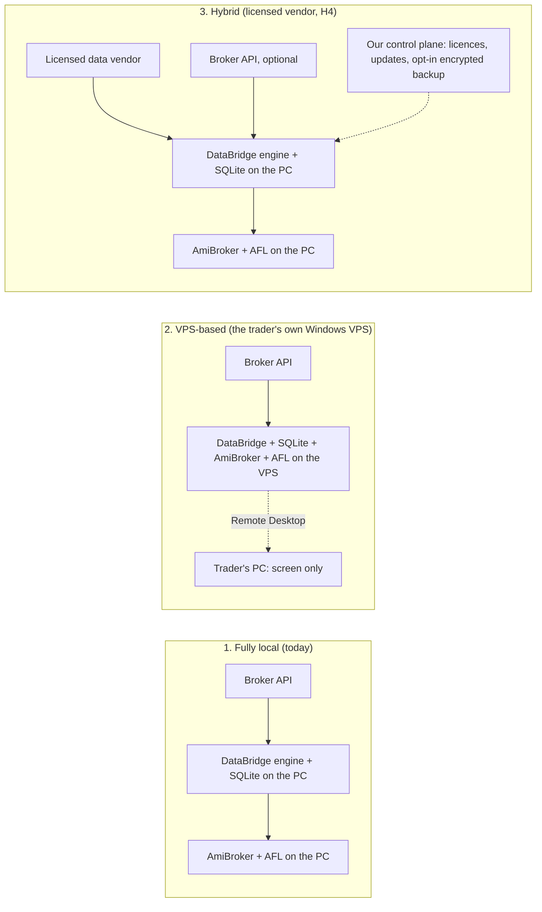

# DataBridge Pro: deployment architecture decision

Written 2026-11-25 to answer five questions before implementation starts:
1. Is a VPS needed?
2. SQLite or PostgreSQL with Prisma?
3. How do traders' strategies stay private?
4. Can a hybrid design work?
5. Which architecture fits a commercial product?

Each answer cites one of these:
- the code at commit `8bdf906`, as file:line;
- a measurement taken on 2026-11-25, labelled **measured**;
- an outside source, linked at the end.

Estimates are labelled **estimate**. Nothing in the software changes because of this document.

The legal and licensing points come from public documents and are **not legal advice**. Confirm them with the brokers and a lawyer before any commercial decision rests on them.

## Decision summary

| Question | Decision | Main reason |
|---|---|---|
| Is a VPS needed? | **No.** DataBridge Pro already runs entirely on the trader's Windows PC, and that is the recommended default. | AmiBroker runs on the trader's PC. Each trader's data comes from their own broker account and its own limits. A server adds a network hop, cost and a point of failure. |
| SQLite or PostgreSQL + Prisma? | **SQLite** for every local install. PostgreSQL only if a multi-user server is built one day. **Prisma for bar data: no, anywhere.** | Ticks are never written to the database. The write load is about 17 rows a second at 1,000 symbols, from one process. The stalls found in the audit come from *where* database work runs, and are fixed within SQLite (roadmap Stages 3–4). |
| Central VPS serving market data to many users | **Not recommended, and not allowed as usually imagined.** | Broker terms forbid sharing credentials, third-party use of the API and redistribution of its data. NSE requires a data-vendor licence to pass feed data to clients. SEBI restricts sharing real-time prices with third parties. |
| Hybrid | **Viable only with a licensed data source:** the local engine connects to an NSE-authorised data vendor, the same way it connects to a broker. Our own servers would handle only licences, updates and opt-in encrypted backups, never market data or strategies. | Keeps every strategy and file local, and stays within data licensing |
| Recommended product shape | **Tier 1: fully local** (default, for everyone). **Tier 2: the same software on the trader's own Windows VPS**, with AmiBroker on that VPS too. **Tier 3 (future, a business decision): a licensed-vendor data source** plus a small control-plane server. | Lets traders choose, keeps strategies private, scales with each user's own hardware and broker account |
| Open question that affects even the current product | Ask each broker for written confirmation that its API data may be used in DataBridge Pro on the client's own PC, as a sold product. | Fyers' API terms (Sec 11) bar using exchange data "for the development of different charting, technical tools". Zerodha's support says Kite data can't be displayed "on other platforms". |

---

## 1. What the software does today (evidence)

| Fact | Evidence |
|---|---|
| Everything runs on the user's PC, bound to localhost | `apps/server/src/config.ts:2` (`HOST = '127.0.0.1'`); the engine listens on 127.0.0.1:7890 (HTTP + WebSocket) and :7891 (AmiBroker channel) |
| The engine is a hidden part of the desktop app | `apps/desktop/src-tauri/src/engine.rs:102-123` (spawned as `local-api.exe`, restarted if it dies) |
| The AmiBroker plugin talks only to this PC | `plugins/amibroker/src/DataClient.cpp:602-603` (TCP 127.0.0.1:7891), `:778` (HTTP 127.0.0.1:7890) |
| The HTTP API has no login of its own; it is safe only because it listens on localhost | `apps/server/src/app.ts:20-57` (CORS, JSON and a logger only); the WebSocket rejects non-local clients (`api/realtime.ts:46-50`) |
| Data lives in one SQLite file per user | `apps/server/src/db/index.ts:59-60` (`%APPDATA%\DataBridgePro\databridge.db`) |
| Broker credentials are encrypted on disk with a key protected by Windows (DPAPI) | `apps/server/src/lib/secretBox.ts`, `apps/desktop/src-tauri/src/secret_key.rs` |
| Each user connects with **their own** broker API key and login | broker routes and `brokers/brokerAuth.ts`; the limits are per account (for example, Fyers Standard: 100 live symbols, 50 history requests a minute, 5,000 a day) |
| Ticks are aggregated in memory into 1-minute bars; only bars are stored | `apps/server/src/market/liveFeed.ts:262-399` (bar building), `:537-554` (only closed bars go to the database) |
| Windows-only parts | PowerShell OLE for AmiBroker symbol details (`amibroker/symbolDetails.ts:112-181`), `reg.exe` (`platforms/windows.ts`), DPAPI; the plugin is a 32-bit Windows DLL |
| PostgreSQL was used before and was replaced by SQLite on 2026-10-25 | `apps/server/src/db/pgImport.ts` only copies old PostgreSQL data once; `pg` is imported nowhere else; no Prisma anywhere in the repository |
| The engine **never reads AFL formulas, layouts or AmiBroker databases** | the only AmiBroker files it looks at are `Formulas`/`Plugins` folders, to recognise an AmiBroker install (`src-tauri/src/amibroker.rs:55-59`); the plugin exchanges only bars, quotes, status and symbol names with the local engine (protocol: `amibroker/ipcServer.ts:1-15`) |

So DataBridge Pro is already a fully local product. A VPS was considered earlier and not chosen (project notes).

---

## 2. Question 1: is a VPS needed?

**No.** Everything DataBridge needs already runs on the trader's PC: the broker connection, bar building, the database, history downloads, gap repair and the AmiBroker plugin.

What a VPS could add, and what it can't:

| Possible benefit of a VPS | Real? | Evidence / reasoning |
|---|---|---|
| Lower latency to AmiBroker | **No**, unless AmiBroker also runs on the VPS | **Measured** TCP round trip from this PC: Fyers socket 50.7 ms median, Kite WebSocket 57.2 ms, Dhan feed 62.9 ms, Dhan REST 19.7 ms. A VPS in Mumbai would typically be a few ms from the brokers (**estimate**, not measured), but its data must still cross the same home connection to reach AmiBroker on the PC: broker → VPS → home is never shorter than broker → home. The bridge's own delays (event-loop stalls, the plugin's 150 ms notice timer) are on the PC and are fixed by the roadmap either way. |
| Keeps collecting data while the trader's PC is off or offline | **Yes** | The local engine fills such gaps from broker history after it reconnects, within the broker's limits (Fyers Standard: 5,000 history requests a day, 1 year of intraday). A VPS that never sleeps avoids those gaps. |
| Better internet uptime than home broadband | **Yes** | Data-centre connectivity is steadier. It helps only if the data's consumer (AmiBroker) is also there. |
| Needed for the product to work | **No** | The current product works without one |

**When a VPS makes sense:** a trader who wants 24×7 capture, or whose home internet is unreliable, can run the **whole stack** on their own Windows VPS: DataBridge Pro, AmiBroker and their AFLs, used over Remote Desktop. That is the same installer and needs no code changes. The trader owns and controls the VPS, so their strategies stay on a machine that belongs to them.

**What is not supported:** the engine on a VPS with AmiBroker on the home PC. The engine's ports have no authentication or encryption, because they are meant only for the same PC (section 1). Exposing them over the internet would be unsafe. Supporting this split would need new work: TLS, per-device keys and a remote mode in the plugin. It would still be slower than running AmiBroker next to the engine, and it isn't recommended.

---

## 3. Question 2: SQLite or PostgreSQL with Prisma?

### The actual workload

| Load | Size at 1,000+ symbols | Evidence |
|---|---|---|
| Live tick rate | thousands of updates a second | broker feeds |
| **Ticks written to the database** | **0**: ticks are folded into 1-minute bars in memory | `liveFeed.ts:262-399`, `:537-554` |
| Live bar writes | 1 row per symbol per minute, so **about 17 rows a second** at 1,000 symbols, committed every 2 s (about 33 rows per commit) | `db/index.ts:375-396` |
| History writes | chunks of 25,000–35,000 rows. About 25 ms per 25,000-row commit (code comment). About 41 ms per chunk end to end (measured 2026-10-26, project notes). | `db/index.ts:14`, `:419-449` |
| Reads for AmiBroker | full load of 100,000 bars in about 65 ms, built in a worker thread | `db/reader.ts:27-29` |
| Storage | about 40 bytes per bar; 1,000 symbols × 1 year (about 94,000 bars each) ≈ **3.8 GB**; 5 years ≈ **19 GB** (**estimate** from 40 bytes per bar) | `db/index.ts:8-10`; `Plugin.cpp:431` |
| Writers | **one process** (the engine) | `db/index.ts:83` |
| Readers | 2 worker threads, reading while the engine writes (WAL) | `db/reader.ts:126` |
| Engine memory | heap about 40 MB, peak RSS 133 MB during downloads | measured 2026-10-26, project notes |

### SQLite's limits, set against this workload

- SQLite allows **one writer at a time per file**. It is a good fit when writes are brief and can take turns. Its authors recommend a client/server engine when many clients write over a network ([SQLite: Appropriate Uses](https://www.sqlite.org/whentouse.html)). WAL mode gives one writer and many readers at once.
- DataBridge has **exactly one writing process** and a light write load, so the single-writer rule is not a constraint. Readers already run alongside it.
- Database size is no issue: SQLite's maximum is far above 19 GB.
- **Durability:** with WAL and `synchronous=NORMAL`, an app crash loses nothing that was committed. A power cut can lose the last commit or so, about the last 2 s of live bars (`db/index.ts:84-85`). The bridge refills those from broker history.

### What actually causes the database-related stalls

The audit's database findings are about **where** the work runs, not which database engine is used:

| Finding | Cause | Does PostgreSQL fix it? |
|---|---|---|
| P1: history parsing and writes on the live thread | JSON parsing, validation and building upsert rows happen in the engine's single JavaScript thread | **No.** That JavaScript work is the same with any database. Roadmap 3a/3e fixes it. |
| P2: WAL checkpoints with disk syncs inside commits | SQLite's default checkpointing runs on the committing connection | PostgreSQL checkpoints in its own background process. Roadmap 4a gets the same effect in SQLite with a maintenance worker. |
| B5: health check scans the whole bars table | a query that can't use the `(tid, ts)` index, on a shared reader | **No.** The same query would scan in PostgreSQL. Roadmap 4b/4c fixes the query and separates the readers. |

### What PostgreSQL would cost on each trader's PC

- **Installation:**
  - a separate database server to install and run as a Windows service;
  - a password and a port (5432, which may clash with another PostgreSQL on the PC);
  - Windows permission and antivirus issues.

  This is why the project moved away from it on 2026-10-25: "clients must not need a PostgreSQL install" (project notes). The old code even had a hard-coded PostgreSQL password fallback.
- **Memory:** a resident server, with `shared_buffers` 128 MB by default, plus one process per connection. That is on top of the engine.
- **Upgrades:** major PostgreSQL versions need dump/restore or `pg_upgrade` on every client PC.
- **Backups:** need PostgreSQL's tools. Today a backup is `VACUUM INTO` a single file (`db/reader.ts:96-101`).
- **Bulk writes** would need multi-row statements (PostgreSQL allows at most 65,535 parameters per statement, so about 8,000 bars per insert) or `COPY`. Each statement is a round trip over a local socket. This is **not measured**: SQLite's in-process commit of 25,000 rows in about 25 ms is unlikely to be beaten on a single PC.

### What Prisma would add

| Point | Detail | Source |
|---|---|---|
| No bulk upsert | `createMany({ skipDuplicates: true })` only does `ON CONFLICT DO NOTHING`. A bulk upsert has been an open request for years. The history write here is a **conditional** upsert (update only when values differ, keep the existing open interest when the broker sends none: `db/index.ts:248-255`). In Prisma that means hand-written SQL through `$executeRaw` anyway, or one upsert per row (35,000 per chunk). | [Prisma issue #10362](https://github.com/prisma/prisma/issues/10362), [Prisma CRUD docs](https://www.prisma.io/docs/orm/prisma-client/queries/crud) |
| Packaging | Prisma 7 dropped the 14 MB Rust engine for a TypeScript query compiler of about 1.6 MB, but it needs a driver adapter. For SQLite that is better-sqlite3, a native add-on that would have to be packaged into the single-file engine. Today `node:sqlite` is built into Node and nothing native ships. No `node:sqlite` adapter was found in Prisma's docs (not verified further). | [Prisma 7 announcement](https://www.prisma.io/blog/announcing-prisma-orm-7-0-0), [Rust-free Prisma](https://www.prisma.io/blog/rust-to-typescript-update-boosting-prisma-orm-performance) |
| Benefit | Typed queries and migrations for the small tables (brokers, symbols, settings: 6 tables with a simple in-memory cache layer, `db/index.ts:235-341`) | — |

**Verdict.** For a standalone local installation, SQLite is sufficient and the better choice. PostgreSQL with Prisma brings no meaningful advantage there and adds install, memory, upgrade and support burden on every client PC.

**Where PostgreSQL does fit:** a multi-user server, if one is ever built (see Tier 3). That server would have many concurrent writers and readers over the network, user accounts, replication and online backups. Even there, bar data should be written with plain SQL or `COPY`, optionally with a time-series extension. Prisma would fit only the account and licence tables.

### Benchmark to run later (if wanted)

Not run now, at the user's choice. If a decision ever depends on exact numbers, run this on a typical client PC:
- **Engines:** SQLite through `node:sqlite` (the WAL settings in `db/index.ts:86-90`) against PostgreSQL 18 on the same PC, both with throwaway databases.
- **Cases:**
  1. upsert a 35,000-bar history chunk (the conditional upsert);
  2. read 100,000 bars as CSV;
  3. a live flush of 1,000 rows;
  4. cases 1–3 while a 1-year health query runs.
- **Report:** p50, p99 and max time, engine-thread blocking, and peak memory of each process.

---

## 4. Question 3: privacy and strategy protection

### What leaves the trader's PC today

| Destination | What is sent | When | Evidence |
|---|---|---|---|
| The trader's own broker | login token, subscribed symbols, history requests | always (this is the data source) | `brokers/adapters/*` |
| Broker and NSE public files | plain downloads of public symbol lists (only the IP address is revealed) | daily, on first use | e.g. `FyersAdapter.ts:118, 445`; `lib/logos.ts` (NSE archives) |
| Logo sites (Groww, TradingView, Dhan) | one request per tracked company (reveals which symbols are tracked), then cached on disk | when a symbol card is first shown | `lib/logos.ts` |
| Google News and Bing | searches containing the **watchlist's company names** | when the news, brief or AI features are used | `ai/news.ts:88-103, 259-271` |
| AI providers (Groq, Anthropic) | the chat, watchlist symbols with their technical readings, news headlines, recent engine errors | **only after the user adds an AI API key** | `ai/AiAssistant.ts:56-89, 398-460`; `ai/GroqAssistant.ts` |
| Google Fonts | a font request on every app start (reveals the IP) | always | `apps/desktop/index.html:9-11` |
| Telemetry, crash reports, updates | **nothing**: there is no update server and no telemetry | — | no such code or endpoint in the app or engine |

AFL formulas, indicators, AmiBroker layouts and databases, and trading logic are never read or sent (section 1).

### Recommended privacy improvements (optional, not part of Stages 0–9)

1. A **"Private mode"** switch in Settings that turns off logos, news and AI in one place, so nothing leaves the PC except broker traffic.
2. Bundle the fonts with the app instead of loading them from Google Fonts.
3. A short "What DataBridge Pro sends" page in the client documentation, generated from the table above.

### Rules for any server component we ever run

1. **Market data flows one way: server to PC.** The server has no API that accepts files, formulas, layouts, databases or strategy settings.
2. **The server sees only what it must:** a licence or device id and the symbols requested (needed to send them). No AmiBroker data, no AFL, no order activity.
3. **No broker credentials on our servers** (section 5).
4. **Encrypted and authenticated links:** TLS 1.3, and a per-device key created on the PC and kept with DPAPI like `secret.key`. Pin the server certificate in the client.
5. **Backups, if offered, are encrypted on the PC with a key that never leaves it.** The server stores only opaque bytes.
6. **Telemetry off by default**; opt-in crash reports, with paths and symbol names removed.
7. **The local product keeps working with no server at all.** A server outage can only remove the optional extras.

---

## 5. Legal and licensing constraints (not legal advice)

These decide what a VPS may legally do, so they come before the architecture comparison.

| Source | What it says (quoted or summarised) | Consequence |
|---|---|---|
| NSE Data & Analytics, domestic pricing (2026) | Vendors must get a prior licence or agreement from NSE Data & Analytics before passing feed data to their clients. The sheet lists large fixed fees for real-time data (summary of the 2026 pricing file). | Serving NSE live data to paying users from our servers needs a vendor licence, or an upstream vendor who holds one |
| SEBI circular, 24 May 2024 (SEBI/HO/MRD/MRD-PoD-3/P/CIR/2024/56), amended 8 May 2026 for educational use | Exchanges and registered intermediaries must ensure no real-time price data is shared with third parties, including platforms, except where needed for orderly market functioning or regulatory requirements. | Brokers are bound not to let their data be passed on, which is why their API terms forbid it |
| Kite Connect terms | "live market data obtained via Kite Connect cannot be displayed to the public at large"; you will not "distribute, publicly display, or sublicense to any third party"; not "build databases, or otherwise create permanent copies of such content"; "Your credentials … are intended to be used only by you"; platforms for other Zerodha clients need "the required exchange approvals" | One Kite login cannot feed other users. Storing Kite data in a database is itself restricted. |
| Zerodha support | "No, you cannot display data from Kite Connect APIs on other platforms, as this violates the exchange's data vending policies." | **Affects even the local product.** Whether a trader's own AmiBroker counts as an "other platform" is not stated. Ask Zerodha in writing. |
| Fyers API terms | Sec 11: do not "Permit the use of the APIs by any third party"; exchange data "shall not be used for the development of different charting, technical tools, paper trading, gaming…". Sec 12: credentials must not be shared "with any third party"; copying, building databases or redistributing API content needs Fyers' written consent. | One Fyers login cannot feed other users, and our servers holding users' Fyers tokens would be credential sharing. **Sec 11 needs a written answer from Fyers about DataBridge Pro as a product, even when fully local.** |

**What follows for each architecture:**
- **Fully local:** each user's own broker data on their own PC is the personal-use case the terms describe. It still needs the written confirmations above, because DataBridge is sold as a tool.
- **Central VPS fed by our broker accounts:** not permitted without NSE licensing; it breaks the broker terms.
- **Central VPS running each user's broker login:** breaks the credential-sharing clauses. It would also concentrate trading-capable tokens on one server: those tokens can place orders, not only read data.
- **A licensed vendor feed:** the lawful way to centralise data. That is what NSE-authorised vendors sell, and Fyers itself tied up with one for its retail data.

---

## 6. Question 4: can a hybrid work?

| Hybrid variant | Technically possible? | Allowed? | Recommendation |
|---|---|---|---|
| **H1:** our VPS ingests from one or a few broker accounts and streams to all users | yes | **no** (section 5); one Fyers Standard account also streams only 100 symbols for everyone | Do not build |
| **H2:** our VPS runs each user's own broker login and streams to that user | yes | conflicts with the credential-sharing clauses; trading tokens on our servers | Do not build |
| **H3:** the user's own VPS runs DataBridge; their PC runs AmiBroker | needs new security work (TLS, device keys, a remote plugin mode); slower than having AmiBroker next to the engine | allowed (the user's own machine) | Not recommended; put AmiBroker on the same VPS instead (Tier 2) |
| **H4:** licensed data vendor → each user's local DataBridge, as an extra data source like a broker; our server only for licences, updates and optional encrypted backup | yes; the local engine already supports many sources (`brokers/adapters/*`, `BackfillQueue.pickRoute` across sources) | yes, under the vendor's licence and terms | **The viable hybrid.** Build only if the business decides to resell a licensed feed. |
| **H5:** our server provides only non-market-data services (licence activation, updates, mirrored public symbol lists, opt-in crash reports) | yes | yes | Useful for a commercial product whatever else is decided |

In H4, market data goes from the vendor straight to each PC. Our server never carries it, so we run no data infrastructure. The user's AmiBroker, AFLs, database and settings stay local.

---

## 7. Question 5: the three architectures compared

"VPS-based" here means the whole stack on the trader's own VPS, because a central VPS that distributes market data is ruled out by section 5. A version with the engine on a VPS and AmiBroker at home (H3) is shown in section 6 and isn't recommended.

| Criterion | 1. Fully local | 2. Trader's own Windows VPS (whole stack) | 3. Hybrid with a licensed vendor (H4) |
|---|---|---|---|
| **Latency to AmiBroker** | Broker → PC (**measured** ≈ 50–63 ms round trip here) + bridge processing (sub-ms when idle once the roadmap is done) + plugin notice (≤ 50 ms after Stage 2). The best possible for AmiBroker on a home PC. | Broker → VPS is typically a few ms (**estimate**) and AmiBroker is on the same machine: the lowest data latency of the three. The trader sees it over Remote Desktop (a screen delay, not a data delay). | Vendor → PC over the same home internet: similar to option 1. It depends on the vendor's network, so measure before choosing a vendor. |
| **Live tick reliability** | Depends on home internet and the PC staying on. Recovers automatically: reconnect, then catch-up from history (roadmap Stage 1 makes Fyers recovery 30–60 s instead of 5–6 min). | Data-centre internet and power. The fewest drops. | Depends on the vendor's uptime. A broker can stay configured as a fallback source. |
| **Historical backfill** | Limited by each broker's plan (Fyers Standard: 5,000 requests a day, 1 year intraday); multi-broker download helps | Same limits, but the machine never sleeps, so fewer gaps need filling | The vendor's history service, usually deeper and faster; it depends on the vendor's plan |
| **Database performance** | SQLite on the PC's disk; about 17 rows/s live at 1,000 symbols; fine on any SSD (an HDD makes checkpoints slower, Stage 4a) | Same software; VPS disks vary, so choose SSD storage | Same as option 1 |
| **Infrastructure cost** | **None for us**; the trader uses their own PC and internet | The trader pays for a Windows VPS. AWS Lightsail lists Windows plans at $14, $22 and $44 a month (region not stated; Mumbai gets half the data allowance; confirm current prices). AmiBroker on the VPS needs enough RAM. | The licensed vendor's fees, our margin on top, plus a small control-plane server. NSE's licence costs are in the lakhs of rupees a year (section 5). |
| **Installation complexity** | One installer (today) | Same installer on the VPS, plus AmiBroker; a setup guide is needed | Local installer plus vendor account and licence activation |
| **Maintenance** | Updates on each PC (no update server today; one could be added under H5) | The trader maintains their VPS (Windows updates, reboots outside market hours) | Us: control-plane uptime, the vendor relationship, licence compliance, support |
| **Privacy and data security** | Strongest: strategies, AFL and data never leave the PC; broker credentials are encrypted locally | Strong: everything sits on a machine the trader controls | Strong if the section 4 rules are followed: only symbol requests and a device id reach the vendor or us |
| **Scalability (more traders)** | Scales without limit: each trader brings their own hardware and broker account, so we run nothing per user | Same: each trader's own VPS | The vendor scales the data. Our control plane is tiny. Licence cost grows per user. |
| **Offline operation and recovery** | AmiBroker keeps its history offline. After an outage, missed minutes are fetched from the broker automatically (subject to its limits). | The VPS keeps capturing while the trader's PC is off or offline | Like option 1, plus the vendor's history for catch-up; with a broker as fallback, it works without the vendor |

Bandwidth for a central fan-out (relevant only if someone revisits H1/H2): at 1,000 symbols and 2 updates a second per symbol, today's text lines (about 100 bytes) come to about 200 KB/s per user. That is about 4.5 GB per user per market day, and about 100 GB per user per month (**estimate**). Serving 100 users would need about 10 TB a month of outbound traffic.

---

## 8. Recommendation

For a commercial product serving traders with different hardware and privacy needs:

1. **Tier 1, the default: fully local.** It is what DataBridge Pro is today and what the roadmap optimizes.
   - It has the best privacy, no infrastructure cost for us, unlimited scaling, and the lowest latency for AmiBroker on a home PC.
   - Hardware guidance for clients, to be confirmed by the Stage 0 harness: an SSD (needed for steady database checkpoints), enough RAM for AmiBroker plus about 150–250 MB for DataBridge, and a stable internet connection.
2. **Tier 2, optional: run the same software on the trader's own Windows VPS**, with AmiBroker and their AFLs on that VPS. No code changes; it needs a setup guide (VPS size, Windows time sync, start with Windows, Remote Desktop).
   - It is for traders who want 24×7 capture or have unreliable home internet.
   - We don't host it, and their strategies stay on their machine.
3. **Tier 3, future, only if the business chooses: a licensed data source.**
   - Partner with or resell an NSE-authorised vendor, added to the engine as another data source (H4).
   - Add a small control-plane server for licences, updates and opt-in encrypted backups (H5), following the rules in section 4.
   - Use PostgreSQL there for accounts and licences, if needed.
   - Market data still flows vendor → PC, and nothing about strategies ever reaches us.
4. **Do not build** a central VPS that streams broker data to users, and never hold users' broker logins on our servers.
5. **Database: keep SQLite.** Do the roadmap's Stage 3–4 database work. Don't adopt Prisma for bar data.
6. **Before selling further, get written confirmation from each supported broker** (start with Fyers and Zerodha) that their API data may be used in DataBridge Pro on the client's own PC. Add privacy mode and bundled fonts when convenient.

## 9. Impact on the implementation roadmap

- **No change to Stages 0–9.** They optimize the fully local architecture recommended here.
- **Keep every engine port bound to 127.0.0.1.** Add no remote, VPS or cloud features during the roadmap.
- **Possible later work**, outside Stages 0–9 and only on the user's request:
  - privacy mode and bundled fonts;
  - a Tier 2 VPS setup guide;
  - an update and licence server (H5);
  - a licensed-vendor data adapter (H4).

## Sources

- SQLite: [Appropriate Uses For SQLite](https://www.sqlite.org/whentouse.html)
- NSE Data & Analytics: [domestic market data pricing (2026)](https://nsearchives.nseindia.com/web/mediaattachment/2026-03/NSE_Pricing_file_-_Domestic_clients_20260309171343.pdf), [NSE data sharing and usage policy](https://nsearchives.nseindia.com/web/sites/default/files/inline-files/NSE_Data_Sharing%26Usage_Policy.pdf)
- SEBI: [Norms for sharing of real time price data to third parties (24 May 2024)](https://www.sebi.gov.in/legal/circulars/may-2024/norms-for-sharing-of-real-time-price-data-to-third-parties_83572.html); NSE notice on the 2026 amendment: [COMP74156](https://nsearchives.nseindia.com/content/circulars/COMP74156.pdf)
- Zerodha: [Kite Connect terms](https://kite.trade/terms), [support: using Kite Connect data on other platforms](https://support.zerodha.com/category/trading-and-markets/kite-api/articles/can-i-use-historical-and-live-data-taken-from-kite-connect-api-on-other-platforms)
- Fyers: [API terms and conditions](https://fyers.in/terms-and-conditions-api/), [Fyers ties up with TrueData](https://community.fyers.in/post/fyers-ties-up-with-truedata-5f40dc9ca9f2036c40234384)
- Prisma: [issue #10362 (upsertMany)](https://github.com/prisma/prisma/issues/10362), [CRUD docs](https://www.prisma.io/docs/orm/prisma-client/queries/crud), [Prisma ORM 7.0.0](https://www.prisma.io/blog/announcing-prisma-orm-7-0-0), [Rust to TypeScript](https://www.prisma.io/blog/rust-to-typescript-update-boosting-prisma-orm-performance)
- AWS: [Lightsail pricing](https://aws.amazon.com/lightsail/pricing), [Lightsail bundles](https://docs.aws.amazon.com/lightsail/latest/userguide/amazon-lightsail-bundles.html)
- Measurements: TCP connect times from this PC to broker endpoints, 7 attempts each, 2026-11-25. Fyers and Kite REST hosts resolve to Cloudflare, so their times are to Cloudflare's edge rather than the broker's own servers.
