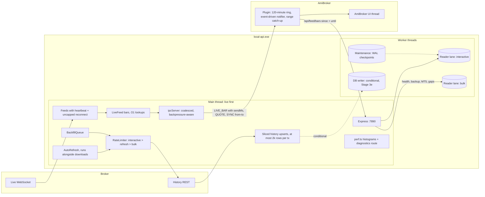
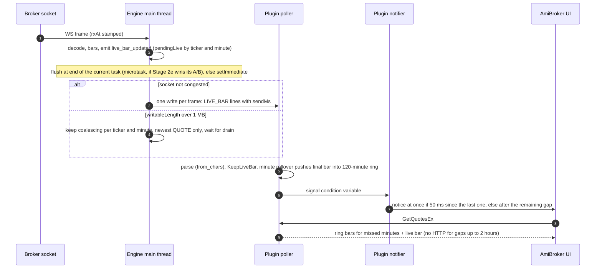
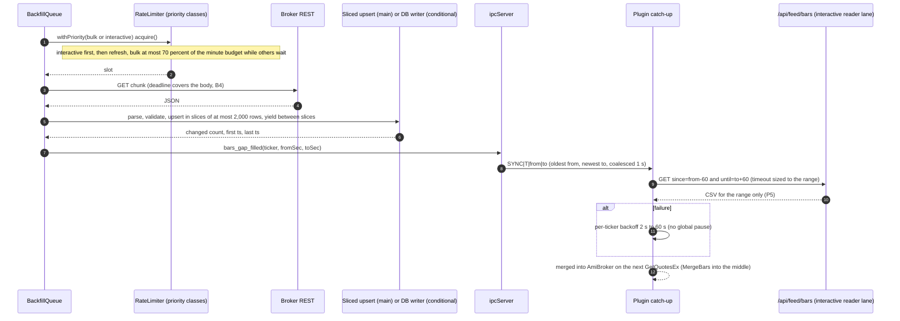
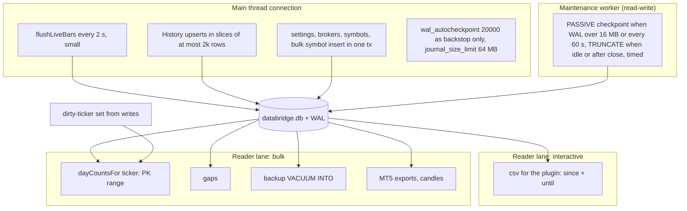
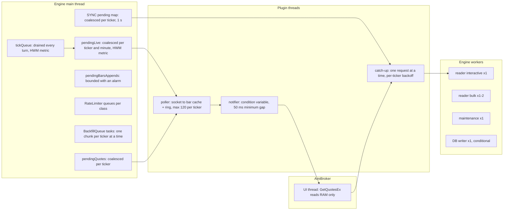
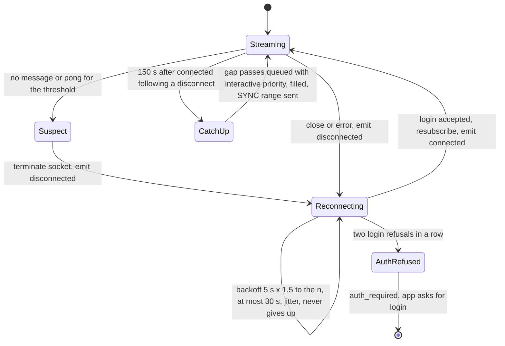

# DataBridge Pro: optimized target architecture

The design the roadmap builds towards. Each change says which finding it answers ([ROOT_CAUSE_ANALYSIS](DATABRIDGE_ROOT_CAUSE_ANALYSIS.md)) and why it is needed. Changes marked **conditional** are built only when a measurement shows they are needed. Nothing here is a rewrite: the engine stays one Node process with the same modules, protocol, database file and UI.

## Design principles

1. **The engine's main thread is for live data.** It keeps socket I/O, tick decoding, bar state, the push to AmiBroker and small HTTP handlers. Synchronous work over about 2 ms is cut into slices or moved to a worker.
2. **Every queue is bounded or coalescing**, and reports its high-water mark. Coalescing is used only where the consumer keeps just the latest state: the same ticker's same minute, or a ticker's latest quote.
3. **No market data is lost.** Every minute's final bar state reaches the plugin and the database. Validation stays.
4. **Live beats history.** A history download or a health check never delays a live update by more than a slice. Interactive history (what AmiBroker is showing) beats the refresh, which beats bulk downloads.
5. **Recovery is automatic and quick.** A dead socket is detected in seconds, reconnects never stop, and the minutes missed are fetched soon after.
6. **Protocol changes are backward compatible.** New fields go at the end of lines. Old parsers already stop at `|`; this was checked for `SYNC` and `LIVE_BAR`.
7. **Everything is measured.** Each stage of the path has a histogram, so every later change is judged on numbers.

## Diagram 7: optimized system architecture

## Diagram 8: optimized live tick processing

**Why each change:**

| Change | Answers | Why |
|---|---|---|
| Event-driven notifier with a 50 ms minimum gap | P3 | Removes the fixed 0–150 ms wait while keeping AmiBroker's redraw rate bounded (at most 20 notices a second) |
| 120-minute ring per ticker in the plugin | P4 | Symbols AmiBroker reads occasionally (scans, watch lists, hidden charts) get their missed minutes from memory at once, instead of from a rate-limited HTTP round trip later and in bulk |
| `from_chars` parsing in the plugin | P13-style CPU | Fewer allocations per line in AmiBroker's process |
| Flush at the end of the current task (measured) | P1 | Today the flush waits a whole loop iteration, behind whatever else is queued. A microtask flush still batches a whole frame into one write. It is adopted only if the A/B test shows lower p99 at an acceptable write rate. |
| Backpressure with lossless coalescing | D1 | Memory stays bounded if AmiBroker stops reading, and the recovery burst is small and correct |
| O(1) lookups and a negative cache | P10 | Removes O(N) string scans per tick and per request |
| Heartbeat and uncapped reconnect for Fyers, plus a disconnect event | B1, B2, B3 | Detects a dead socket in 30–60 s instead of 5–6 min, never gives up, and triggers the 150 s catch-up |

## Diagram 9: optimized backfill architecture

**Why each change:**

| Change | Answers | Why |
|---|---|---|
| Sliced upserts with yields | P1, D5 | One chunk becomes about 15 slices of a few ms each, so live ticks interleave instead of waiting 25–80 ms |
| DB writer worker (conditional, Stage 3e) | P1 | Only if slicing doesn't meet the loop-lag target: parsing and writing then leave the main thread entirely |
| Priority classes through AsyncLocalStorage | P6 | Gap fills for symbols AmiBroker is showing and the refresh no longer queue behind bulk years. No adapter signature changes. |
| AutoRefresh runs alongside downloads | P6 | On capped plans the refresh is the only source for non-live symbols; it must not stop for a 40-minute download |
| `SYNC` with a range, range fetch, size-based timeouts, per-ticker backoff | P5, B5 | The plugin downloads what changed instead of everything up to now, and one slow answer no longer freezes every symbol for 15 s |
| Live-place swaps only for repeatedly viewed symbols | P7 | Scans stop churning subscriptions and queuing forced downloads |

## Diagram 10: optimized database architecture

**Why each change:**

| Change | Answers | Why |
|---|---|---|
| Checkpoints in a maintenance worker | P2 | The commit that crosses 1,000 pages no longer runs a disk-syncing checkpoint on the live thread |
| `journal_size_limit` | P2 | The WAL file shrinks back after a large checkpoint |
| Interactive and bulk reader lanes, least-loaded dispatch | B5 | AmiBroker's requests never queue behind a health scan, a backup or an MT5 export |
| Incremental health counts for dirty tickers only, by PK range | B5 | Replaces a whole-table scan every 30 s with small indexed queries for the symbols that changed |
| `cache_size` and `mmap_size` (A/B tested) | C1 | Kept only if measurements show faster upserts or reads |
| Debounced async state files | P8 | Removes bursts of synchronous whole-file writes |

The schema is unchanged. No new indexes are added unless `EXPLAIN QUERY PLAN` shows a scan; all hot queries are `tid = ? AND ts` ranges on the primary key.

## Diagram 11: threading and queue architecture

Bounds:

| Queue | Bound |
|---|---|
| `tickQueue` | drained every turn; HWM recorded |
| `pendingLive` | at most symbols × 2 entries (current and previous minute) |
| Socket buffer | about 1 MB; above that, writing pauses until drain while state keeps coalescing |
| Plugin ring | 120 bars per ticker |
| Plugin pending notices | one per ticker |
| Catch-up jobs | one per ticker, de-duplicated by `g_catchUpPending` |
| `pendingBarsAppends` | about symbols × minutes until the next flush, with an alarm if a DB failure makes it grow |
| Rate-limiter queues | bounded by the backfill slots (6 per broker) plus the refresh pool (6) plus interactive callers |

## Diagram 12: failure recovery architecture

Other recovery paths:

| Failure | Detection | Recovery |
|---|---|---|
| Engine crash | supervisor polls every 500 ms | restart with backoff. The plugin reconnects within 1 s, and the new connection generation makes every viewed symbol re-sync its last 24 h. Measure this storm in Stage 8 and spread it if needed. |
| AmiBroker restart | the plugin connects | full loads on first view; status, quotes and (only if the content changed) symbol details are pushed |
| App window closed | — | the engine keeps running until a clean shutdown request; behaviour unchanged |
| Disk slow or database locked | `db.*` histograms; `busy_timeout` | sliced transactions keep each hold short; the live-bar buffer is bounded with an alarm; nothing is dropped |
| Plugin stops reading | `writableLength` | lossless coalescing, then resume on drain |
| Network outage | feed heartbeat | reconnect; minutes missed during the outage are fetched by the post-reconnect catch-up |

## What is deliberately not changed

- The process layout (Tauri app + engine sidecar + plugin), the ports, the database file and schema, the HTTP API and the UI.
- How the live feed builds bars (exchange-time minutes, close once, history replaces them) and the 30-second settle rule for broker bars.
- "One notice per round" in the plugin, and the requeue when AmiBroker is busy.
- Validation and repair of history bars.

## Optional future work (needs a product decision)

- **Live overflow to a second broker:** symbols beyond Fyers Standard's 100 live places streamed by another connected broker, such as Kite or Dhan. This removes the refresh-only lag for those symbols, but needs a symbol-routing design and the user's agreement.
- **A user setting for the notifier gap** (for example 25–150 ms), for clients with heavy AmiBroker layouts.
